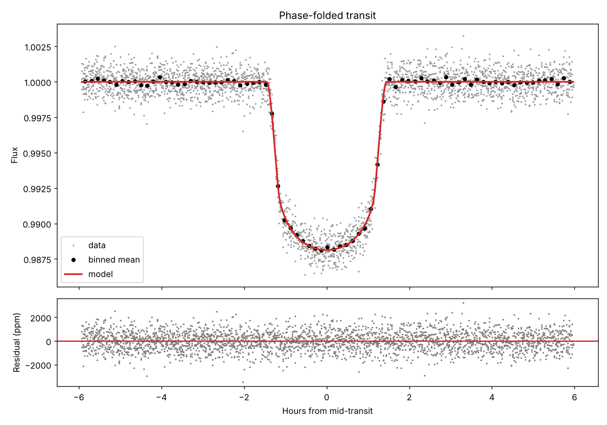

# Transit Hunter

A Python pipeline that takes a star's light curve from TESS (or Kepler), finds planets crossing in front of it, and measures their radius, orbit, and inclination.

## The science problem

When a planet crosses its star's disk, it blocks a tiny fraction of the light. The depth of this dip is approximately `(Rp / R*)²`. For a Jupiter in front of a Sun-like star, that is ~1%. For an Earth, ~0.008% (84 ppm). The challenge is finding this periodic dip buried in instrumental noise and the star's own natural variability.

## Pipeline

| Step | What it does | Tool |
|---|---|---|
| 1. Data | Downloads and stitches TESS sectors (PDCSAP flux) | `lightkurve` |
| 2. Lomb-Scargle | Finds sinusoidal variability (rotation, pulsation). Manual implementation + astropy | `astropy.timeseries` |
| 3. Detrending + BLS | Removes stellar variability and searches for box-shaped dips | `BoxLeastSquares` |
| 4. Fit | Physical transit model with limb darkening | `batman` + `scipy` |
| 5. Physics | Converts to planet radius, semi-major axis, stellar density, temperature | `astropy.units` |

## Usage

```bash
python -m venv .venv
source .venv/bin/activate
pip install -r requirements.txt

python pipeline.py --synthetic --teff 5800
python pipeline.py --target "WASP-18" --star-radius 1.2 --star-mass 1.2 --teff 6400
```

Stellar parameters (`--star-radius`, `--star-mass`, `--teff`) should come from the NASA Exoplanet Archive or the TESS Input Catalog. The values above are approximate; verify them before use.

Outputs go to `output/`: four figures and a `results.json`.

## Validation with a synthetic planet

`--synthetic` injects a hot Jupiter (P = 3.2 d, Rp/R* = 0.10, a/R* = 9, i = 88°) with 5.3 d stellar rotation and 800 ppm noise, then checks whether the pipeline recovers what was injected:

| Parameter | Injected | Recovered |
|---|---|---|
| Period (d) | 3.2000 | 3.19999 ± 0.00004 |
| Rp/R* | 0.1000 | 0.1004 ± 0.0005 |
| a/R* | 9.00 | 8.87 ± 0.17 |
| Inclination (°) | 88.0 | 87.71 ± 0.36 |



## Limitations

- Circular orbits and fixed limb-darkening coefficients are assumed.
- Uncertainties come from the least-squares covariance matrix, which underestimates errors when `a/R*` and inclination are degenerate. The next step is MCMC (`emcee`).
- BLS only finds the strongest signal. For multi-planet systems, mask the first planet and run again.
- A BLS signal is not a confirmed planet: background eclipsing binaries and instrumental systematics can mimic transits.

## References

- Winn, J. (2010). *Transits and Occultations*. arXiv:1001.2010
- VanderPlas, J. (2018). *Understanding the Lomb-Scargle Periodogram*. arXiv:1703.09824
- Kovács, Zucker & Mazeh (2002). *A box-fitting algorithm in the search for periodic transits*. astro-ph/0206099
- Mandel & Agol (2002). *Analytic Light Curves for Planetary Transit Searches*. astro-ph/0210099
- Kreidberg, L. (2015). *batman: BAsic Transit Model cAlculatioN in Python*. arXiv:1507.08285
